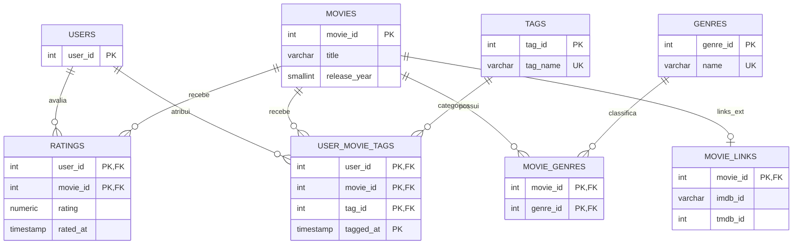
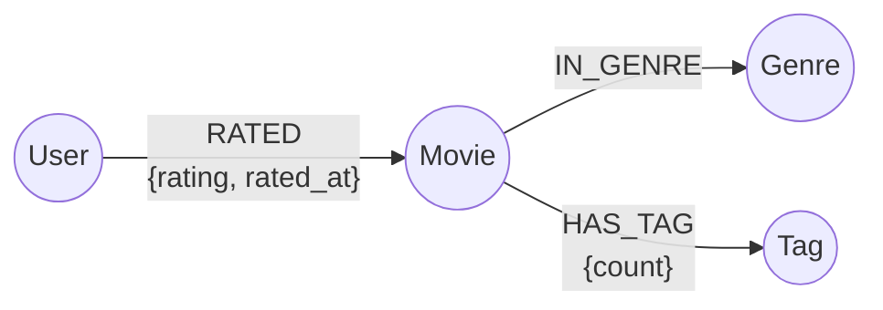

# Análise Comparativa: Banco de Dados Relacional (PostgreSQL) vs. Banco de Dados em Grafo (Neo4j)

**Dataset analisado:** MovieLens 20M (GroupLens Research)  
**Contexto:** estudo comparativo entre os paradigmas **Relacional (3FN)** e **NoSQL orientado a Grafos (Property Graph)**.

---

## 1. Introdução e Contextualização do Problema

O objetivo deste estudo é modelar, implementar e confrontar duas abordagens de gerenciamento de dados sobre a mesma base pública: o dataset **MovieLens 20M**.

O dataset é composto por atributos cadastrais de filmes (`movie.csv`), links para catálogos externos (`link.csv`), termos atribuídos livremente por usuários (`tag.csv`) e mais de **20 milhões de avaliações** numéricas (`rating.csv`).

Escolhemos um banco em **grafo** como contraponto ao relacional porque o MovieLens é, na sua essência, uma **rede**: usuários ligados a filmes pelas avaliações, filmes ligados a gêneros e a tags. A pergunta mais valiosa que se faz a esse tipo de dado — *"que filme recomendar a esta pessoa?"* — é uma pergunta sobre **caminhos** nessa rede.

1. **Paradigma Relacional**: dados em tabelas, **sem redundância** pelas regras de normalização (1FN, 2FN e 3FN), com integridade garantida por chaves primárias e estrangeiras e transações **ACID**. Relacionamentos são *calculados* no momento da consulta, via `JOIN`.
2. **Paradigma em Grafo**: dados como **nós** (entidades) e **arestas** (relacionamentos), ambos com propriedades. Relacionamentos são *armazenados* fisicamente: cada nó guarda ponteiros diretos para seus vizinhos (*index-free adjacency*), de modo que percorrer uma aresta custa o mesmo independentemente do tamanho total da base.

---

## 2. Modelagem e Estrutura de Dados

### 2.1. Abordagem Relacional (PostgreSQL - 3FN)

A base bruta foi normalizada da seguinte forma:

* **1ª Forma Normal (1FN)** — todo atributo deve ser atômico:
  * O atributo multivalorado `genres` (ex.: `"Action|Adventure|Sci-Fi"`) foi decomposto na tabela catálogo `genres` e na associativa $N:M$ `movie_genres`.
  * O título composto `"Toy Story (1995)"` foi separado em `title` e `release_year`.
* **2ª Forma Normal (2FN)** — nenhum atributo não-chave pode depender de **parte** de uma chave composta. Em `ratings`, a chave é `(user_id, movie_id)` e tanto `rating` quanto `rated_at` dependem do par completo (a nota é *de um usuário para um filme*). Não há dependência parcial: a tabela já está em 2FN. O mesmo vale para `movie_genres` e `user_movie_tags`.
* **3ª Forma Normal (3FN)** — nenhum atributo não-chave pode depender de outro atributo não-chave. Em `movies`, `title` e `release_year` dependem apenas de `movie_id`; em `movie_links`, `imdb_id` e `tmdb_id` também. Não há dependências transitivas no modelo.

Duas decisões **de projeto** (que vão além do exigido pela 3FN) merecem registro:

* **Catálogo de tags** (`tags` + `user_movie_tags`): o texto da tag não depende transitivamente de nada — ele é o próprio dado. Separá-lo num catálogo com chave substituta (`tag_id`) é uma escolha para **evitar repetir a mesma string** em centenas de milhares de linhas e padronizar a grafia (minúsculas, sem espaços nas pontas).
* **Links externos em tabela 1:1** (`movie_links`): também não é exigência da 3FN (os IDs dependem diretamente de `movie_id`). A separação isola metadados de fontes externas que nem todo filme possui (`tmdb_id` ausente em alguns casos).



> O diagrama editável está em [`der.drawio`](der.drawio) e o modelo lógico em [`modelo_logico.puml`](modelo_logico.puml).

* **Resultado relacional**: **8 tabelas**.

---

### 2.2. Abordagem em Grafo (Neo4j)

No grafo, a pergunta de modelagem muda de *"quais são as dependências funcionais?"* para *"quais são as coisas e como elas se ligam?"*. Cada tabela associativa do modelo relacional deixa de existir e vira **aresta**.



| Elemento | Tipo | Propriedades | Origem relacional |
| :--- | :--- | :--- | :--- |
| `(:User)` | nó | `user_id` | `users` |
| `(:Movie)` | nó | `movie_id`, `title`, `release_year`, `imdb_id`, `tmdb_id` | `movies` + `movie_links` |
| `(:Genre)` | nó | `name` | `genres` |
| `(:Tag)` | nó | `name` | `tags` |
| `[:RATED]` | aresta User → Movie | `rating`, `rated_at` | `ratings` |
| `[:IN_GENRE]` | aresta Movie → Genre | — | `movie_genres` |
| `[:HAS_TAG]` | aresta Movie → Tag | `count` (quantos usuários aplicaram a tag) | `user_movie_tags` agregado |

Decisões de modelagem:

* **Tabelas associativas viram arestas**: `ratings` e `movie_genres` não são entidades, são relações. No grafo, a nota e a data passam a ser **propriedades da aresta** `RATED`.
* **Links externos como propriedades do filme**: uma relação 1:1 não justifica um nó próprio; `imdb_id` e `tmdb_id` ficam no nó `:Movie`.
* **Tags agregadas por filme**: a etiquetagem original é uma relação **ternária** (usuário, filme, tag), e arestas no modelo de grafo de propriedades ligam só **dois** nós. Representá-la fielmente exigiria *reificar* a relação num nó intermediário `(:Tagging)`. Como todas as consultas usam as tags para descrever filmes, optamos por uma aresta `HAS_TAG` por par (filme, tag), com a propriedade `count`. **Perde-se** a informação de quem aplicou a tag e quando — uma limitação consciente, registrada aqui.
* **Integridade mínima**: o Neo4j não tem esquema obrigatório nem chaves estrangeiras. As únicas garantias impostas pelo banco são as *constraints* de unicidade em `user_id`, `movie_id`, `Genre.name` e `Tag.name` (ver [`neo4j/schema.cypher`](../neo4j/schema.cypher)). Em compensação, uma aresta **não pode** apontar para um nó inexistente: não existem "referências órfãs" no grafo.

* **Resultado em grafo**: **4 rótulos de nó** e **3 tipos de aresta**.

---

## 3. Confronto Direto de Consultas (SQL vs. Cypher)

As sete consultas abaixo estão em [`relational/queries.sql`](../relational/queries.sql) e [`neo4j/queries.cypher`](../neo4j/queries.cypher), e devolvem **os mesmos resultados** nos dois bancos (verificado pelos scripts `test_sql_queries.py` e `test_graph_queries.py`). Elas foram escolhidas para cobrir os dois lados: consultas em que o relacional é naturalmente forte (agregações sobre a base inteira) e consultas em que o grafo é naturalmente forte (navegar relacionamentos).

### Consulta 1: Ficha completa de um filme

```sql
SELECT m.movie_id, m.title, m.release_year, l.imdb_id, l.tmdb_id,
       (SELECT string_agg(g.name, ', ' ORDER BY g.name)
          FROM movie_genres mg JOIN genres g ON g.genre_id = mg.genre_id
         WHERE mg.movie_id = m.movie_id) AS genres,
       r.total_ratings, r.avg_rating
FROM movies m
LEFT JOIN movie_links l ON l.movie_id = m.movie_id
CROSS JOIN LATERAL (
    SELECT COUNT(*) AS total_ratings, ROUND(AVG(rating), 2) AS avg_rating
      FROM ratings WHERE movie_id = m.movie_id
) r
WHERE m.movie_id = 1;
```

```cypher
MATCH (m:Movie {movie_id: 1})
OPTIONAL MATCH (m)-[:IN_GENRE]->(g:Genre)
WITH m, g ORDER BY g.name
WITH m, collect(g.name) AS genres
OPTIONAL MATCH (:User)-[r:RATED]->(m)
RETURN m.movie_id, m.title, m.release_year, m.imdb_id, m.tmdb_id, genres,
       count(r) AS total_ratings, round(avg(r.rating), 2) AS avg_rating;
```

* **Armadilha do SQL**: a versão ingênua (juntar `movie_genres` e `ratings` no mesmo `FROM`) multiplica cada avaliação pelo número de gêneros do filme e infla a contagem. Por isso as avaliações são agregadas numa subconsulta `LATERAL`. No Cypher o problema não aparece: os gêneros são coletados antes de expandir as avaliações.

### Consulta 2: Top 10 filmes mais bem avaliados (mínimo de 50 votos)

```sql
SELECT m.movie_id, m.title, m.release_year,
       COUNT(*) AS vote_count, ROUND(AVG(r.rating), 3) AS average_rating
FROM movies m
JOIN ratings r ON r.movie_id = m.movie_id
GROUP BY m.movie_id, m.title, m.release_year
HAVING COUNT(*) >= 50
ORDER BY AVG(r.rating) DESC, vote_count DESC, m.movie_id
LIMIT 10;
```

```cypher
MATCH (:User)-[r:RATED]->(m:Movie)
WITH m, count(r) AS vote_count, avg(r.rating) AS media
WHERE vote_count >= 50
RETURN m.movie_id, m.title, m.release_year, vote_count, round(media, 3) AS average_rating
ORDER BY media DESC, vote_count DESC, m.movie_id
LIMIT 10;
```

* **Terreno do relacional**: é uma agregação sobre **todas** as avaliações. O PostgreSQL lê a tabela `ratings` sequencialmente (dados contíguos, compactos) e agrupa com *hash aggregate*. O Neo4j precisa visitar cada aresta `RATED` individualmente.

### Consulta 3: Filmes e média das avaliações por gênero

```sql
SELECT g.name AS genre, COUNT(DISTINCT mg.movie_id) AS total_movies,
       COUNT(r.rating) AS total_ratings, ROUND(AVG(r.rating), 2) AS avg_genre_rating
FROM genres g
JOIN movie_genres mg ON mg.genre_id = g.genre_id
LEFT JOIN ratings r  ON r.movie_id = mg.movie_id
GROUP BY g.genre_id, g.name
ORDER BY total_movies DESC, genre;
```

```cypher
MATCH (g:Genre)<-[:IN_GENRE]-(m:Movie)
OPTIONAL MATCH (:User)-[r:RATED]->(m)
WITH g, count(DISTINCT m) AS total_movies, count(r) AS total_ratings, avg(r.rating) AS media
RETURN g.name AS genre, total_movies, total_ratings, round(media, 2) AS avg_genre_rating
ORDER BY total_movies DESC, genre;
```

* A média é calculada sobre **todas as avaliações** dos filmes do gênero (filmes com mais votos pesam mais), igual nos dois bancos.

### Consulta 4: Filmes marcados com `pixar` ou `animation`

```sql
SELECT m.movie_id, m.title, m.release_year, string_agg(DISTINCT t.tag_name, ', ') AS matched_tags
FROM movies m
JOIN user_movie_tags umt ON umt.movie_id = m.movie_id
JOIN tags t              ON t.tag_id = umt.tag_id
WHERE t.tag_name IN ('pixar', 'animation')
GROUP BY m.movie_id, m.title, m.release_year
ORDER BY m.movie_id LIMIT 20;
```

```cypher
MATCH (m:Movie)-[:HAS_TAG]->(t:Tag)
WHERE t.name IN ['pixar', 'animation']
WITH m, t.name AS tag ORDER BY tag
WITH m, collect(tag) AS matched_tags
RETURN m.movie_id, m.title, m.release_year, matched_tags
ORDER BY m.movie_id LIMIT 20;
```

* O Neo4j encontra os dois nós `:Tag` pelo índice de unicidade e então só segue as arestas que saem deles. O SQL faz o mesmo caminho lógico, mas via índices em `tags.tag_name` e `user_movie_tags.tag_id`.

### Consulta 5: "Quem gostou de Toy Story também gostou de..." (recomendação, 2 saltos)

```sql
SELECT m.movie_id, m.title, COUNT(*) AS score
FROM ratings r1
JOIN ratings r2 ON r2.user_id = r1.user_id AND r2.movie_id <> r1.movie_id
JOIN movies m   ON m.movie_id = r2.movie_id
WHERE r1.movie_id = 1 AND r1.rating >= 4 AND r2.rating >= 4
GROUP BY m.movie_id, m.title
ORDER BY score DESC, m.movie_id LIMIT 10;
```

```cypher
MATCH (:Movie {movie_id: 1})<-[r1:RATED]-(u:User)-[r2:RATED]->(rec:Movie)
WHERE r1.rating >= 4 AND r2.rating >= 4
RETURN rec.movie_id, rec.title, count(u) AS score
ORDER BY score DESC, rec.movie_id LIMIT 10;
```

* **Legibilidade**: o padrão Cypher é o desenho do próprio caminho *filme ← usuário → outro filme*. No SQL, a mesma ideia exige um *self-join* da tabela `ratings` com ela mesma, que é bem menos evidente para quem lê.
* **Desempenho**: com 2 saltos e os índices certos (`ratings(movie_id)` e a PK que começa por `user_id`), o PostgreSQL resolve bem. A diferença de desempenho do grafo aparece com **mais saltos** — ver Consulta 7.

### Consulta 6: Filmes com mais tags em comum com Toy Story

```sql
WITH movie_tag AS (SELECT DISTINCT movie_id, tag_id FROM user_movie_tags)
SELECT m.movie_id, m.title, COUNT(*) AS tags_em_comum,
       string_agg(t.tag_name, ', ' ORDER BY t.tag_name) AS tags
FROM movie_tag a
JOIN movie_tag b ON b.tag_id = a.tag_id AND b.movie_id <> a.movie_id
JOIN movies m    ON m.movie_id = b.movie_id
JOIN tags t      ON t.tag_id = a.tag_id
WHERE a.movie_id = 1
GROUP BY m.movie_id, m.title
ORDER BY tags_em_comum DESC, m.movie_id LIMIT 10;
```

```cypher
MATCH (:Movie {movie_id: 1})-[:HAS_TAG]->(t:Tag)<-[:HAS_TAG]-(o:Movie)
WITH o, t.name AS tag ORDER BY tag
RETURN o.movie_id, o.title, count(*) AS tags_em_comum, collect(tag) AS tags
ORDER BY tags_em_comum DESC, o.movie_id LIMIT 10;
```

* Similaridade por vizinhança: dois filmes são parecidos se compartilham vizinhos (tags). No SQL é preciso primeiro **deduplicar** `user_movie_tags` (vários usuários aplicam a mesma tag ao mesmo filme); no grafo esse trabalho já foi feito na carga, com a aresta `HAS_TAG {count}`.

### Consulta 7: Sugestão por gênero — filmes parecidos com Toy Story (gêneros em comum, desempate por tags)

```sql
WITH movie_tag AS (SELECT DISTINCT movie_id, tag_id FROM user_movie_tags),
por_tag AS (
    SELECT b.movie_id, COUNT(*) AS tags
    FROM movie_tag a
    JOIN movie_tag b ON b.tag_id = a.tag_id AND b.movie_id <> a.movie_id
    WHERE a.movie_id = 1
    GROUP BY b.movie_id
)
SELECT m.movie_id, m.title, COUNT(DISTINCT mg.genre_id) AS generos_em_comum, t.tags AS tags_em_comum
FROM por_tag t
JOIN movies m        ON m.movie_id = t.movie_id
JOIN movie_genres mg ON mg.movie_id = m.movie_id
WHERE mg.genre_id IN (SELECT genre_id FROM movie_genres WHERE movie_id = 1)
GROUP BY m.movie_id, m.title, t.tags
ORDER BY generos_em_comum DESC, t.tags DESC, m.movie_id
LIMIT 10;
```

```cypher
MATCH (:Movie {movie_id: 1})-[:HAS_TAG]->(t:Tag)<-[:HAS_TAG]-(m:Movie)
WITH m, count(t) AS tags_em_comum
MATCH (:Movie {movie_id: 1})-[:IN_GENRE]->(g:Genre)<-[:IN_GENRE]-(m)
RETURN m.movie_id, m.title, count(g) AS generos_em_comum, tags_em_comum
ORDER BY generos_em_comum DESC, tags_em_comum DESC, m.movie_id
LIMIT 10;
```

Sugestão de conteúdo: "quem é parecido com Toy Story?", medido por **gêneros em comum** e, no empate, por **tags em comum**. A pergunta cruza duas vizinhanças diferentes do mesmo filme (gêneros e tags):

* **No grafo**, são dois caminhos de 2 saltos que partem do mesmo nó: `Movie → Tag → Movie` e `Movie → Genre → Movie`. A consulta é o desenho desses caminhos.
* **No SQL**, a vizinhança por tags exige o *self-join* da tabela de tags (deduplicada), que é a parte cara; depois ainda é preciso juntar `movie_genres` e agrupar. São duas agregações encadeadas sobre tabelas de junção.
* O Neo4j só toca nas arestas dos filmes que realmente são vizinhos de Toy Story; o SQL materializa o join de tags e só depois filtra por gênero.

---

## 4. Resultados do Benchmark

O script [`scripts/benchmark.py`](../scripts/benchmark.py) executa cada consulta nos dois bancos (1 execução de aquecimento + mediana de 5) e grava a tabela em [`resultados_benchmark.md`](resultados_benchmark.md).

> **Preencher com os números da execução real** (`python scripts/benchmark.py`), indicando o volume de avaliações carregado (amostra de 100 mil ou base completa) e a máquina usada.

O padrão esperado, observado num teste preliminar com **dados sintéticos** no formato do MovieLens (3 mil filmes, 100 mil avaliações), é:

* **Consultas 1 a 4 (busca pontual e agregações)**: o **PostgreSQL** é mais rápido ou empata. Agregar sobre a base inteira favorece o armazenamento em tabelas contíguas, e as buscas pontuais são resolvidas por índices B-Tree nos dois bancos.
* **Consultas 5 e 6 (1 a 2 saltos)**: o **PostgreSQL continua competitivo** (no teste, ficou próximo do Neo4j na 6 e foi mais rápido na 5). Com poucos saltos, junções indexadas são eficientes, e a vantagem do grafo aqui é a legibilidade da consulta, não o tempo.
* **Consulta 7 (sugestão por gênero e tags)**: o **Neo4j** é várias vezes mais rápido, porque a recomendação é a combinação de duas vizinhanças (gêneros e tags) do mesmo filme.

A conclusão honesta é que o grafo **não** é "mais rápido" em geral: ele é mais rápido quando a pergunta cruza **vizinhanças de relacionamentos** (tags, gêneros), como nas recomendações.

---

## 5. Análise Comparativa Detalhada

### 5.1. Esquema, Flexibilidade e Integridade

| Critério | Relacional (PostgreSQL) | Grafo (Neo4j) |
| :--- | :--- | :--- |
| **Definição de esquema** | *Schema-on-write*: tabelas e tipos definidos antes da carga. | Sem esquema obrigatório; rótulos e propriedades livres. Constraints opcionais. |
| **Evolução** | Exige `ALTER TABLE` / migrações. | Novos tipos de nó ou aresta podem ser criados a qualquer momento, sem afetar os existentes. |
| **Integridade referencial** | Garantida pelo motor (`FOREIGN KEY`, `ON DELETE CASCADE`, `CHECK`). | Arestas sempre ligam nós existentes (não há "FK órfã"), mas não há `CHECK` de domínio (ex.: nota entre 0,5 e 5) nem tipos obrigatórios. |
| **Relacionamentos** | Calculados no momento da consulta (`JOIN`). | Armazenados fisicamente (ponteiros entre nós). |
| **Relações ternárias** | Naturais (tabela com 3 chaves estrangeiras). | Exigem reificação em um nó intermediário. |

### 5.2. Transações e Consistência

* **PostgreSQL**: ACID completo. Uma operação composta (cadastrar usuário, registrar nota, aplicar tag) é gravada inteira ou revertida (`ROLLBACK`).
* **Neo4j**: também é **ACID** — diferente de muitos NoSQL, toda escrita ocorre em transação, com isolamento *read committed*.
* **Teorema CAP**: um servidor Neo4j isolado (como neste projeto) não tem partição de rede a considerar. Em cluster, o Neo4j replica as escritas por consenso (Raft) entre os servidores primários, priorizando **consistência** — comportamento tipicamente **CP**. Réplicas secundárias de leitura recebem os dados de forma assíncrona e podem estar ligeiramente atrasadas. O PostgreSQL com replicação síncrona também se comporta como CP; com replicação assíncrona, as réplicas de leitura podem ficar defasadas.

### 5.3. Desempenho e Armazenamento

1. **Custo de percorrer relações**: no relacional, cada `JOIN` é uma busca num índice B-Tree — custo **O(log n)** que cresce com o tamanho da tabela. No grafo, seguir uma aresta é seguir um ponteiro — custo **constante**, independente do tamanho total da base (*index-free adjacency*). Com 1 ou 2 saltos a diferença é pequena; com caminhos longos ela se multiplica a cada salto.
2. **Agregações globais**: o relacional vence. Tabelas são armazenadas de forma contígua e compacta (`NUMERIC(2,1)`, `INTEGER`), ideais para varredura sequencial. O grafo armazena registros de tamanho fixo ligados por ponteiros, menos eficientes para "ler tudo".
3. **Armazenamento**: cada aresta no Neo4j guarda ponteiros para os dois nós e para as arestas vizinhas, o que tende a ocupar **mais espaço** que a linha equivalente numa tabela relacional.
4. **Carga em massa**: o `COPY` do PostgreSQL é extremamente eficiente. No Neo4j, a carga via Cypher (`UNWIND` em lotes) é mais lenta; para a base completa, o caminho recomendado seria o `neo4j-admin database import`, que monta os arquivos do grafo offline.
5. **Escalabilidade**: ambos escalam principalmente **verticalmente** para escrita. Grafos são difíceis de particionar (*sharding*) justamente porque cortar o grafo quebra os caminhos — uma limitação estrutural do modelo.

---

## 6. Matriz Síntese de Decisão

| Dimensão | Relacional (PostgreSQL) | Grafo (Neo4j) |
| :--- | :--- | :--- |
| Unidade de dado | Tabela / linha | Nó / aresta |
| Normalização | Estrita até a 3FN | Não se aplica: relações são cidadãs de primeira classe |
| Relacionamentos | `JOIN` calculado na consulta | Ponteiros armazenados |
| Linguagem | SQL (declarativa, padrão ISO) | Cypher (declarativa, baseada em padrões; base do padrão ISO GQL) |
| Agregações sobre a base inteira | **Forte** | Mais lento |
| Caminhos de tamanho variável | CTE recursiva, cara e limitada | **Nativo** (`shortestPath`, `*1..n`) |
| Integridade | FK, `CHECK`, tipos | Unicidade e existência; sem `CHECK` |
| Transações | ACID | ACID |
| Caso de uso no MovieLens | Catálogo, relatórios, BI | Recomendação, similaridade, exploração da rede |

---

## 7. Conclusão e Recomendações

1. **Quando adotar o modelo relacional (PostgreSQL)**:
   * Quando as perguntas são principalmente **agregações** e relatórios sobre grandes volumes (médias, contagens, rankings).
   * Quando a **integridade estrita** (tipos, domínios, chaves estrangeiras) é obrigatória.
   * Para análises *ad hoc* de BI, em que as perguntas não são conhecidas de antemão.

2. **Quando adotar o modelo em grafo (Neo4j)**:
   * Quando as perguntas são sobre **conexões**: recomendação, "amigos de amigos", caminhos, comunidades, detecção de fraude.
   * Quando o número de saltos é **variável ou desconhecido** na hora de escrever a consulta.
   * Quando o modelo de relacionamentos muda com frequência (novos tipos de aresta sem migração).

3. **Arquitetura recomendada (persistência poliglota)**: numa plataforma real inspirada no MovieLens, os dois convivem:
   * **PostgreSQL** como fonte da verdade: cadastro de usuários, filmes, avaliações e assinaturas, com integridade estrita e relatórios.
   * **Neo4j** alimentado a partir do PostgreSQL, servindo o motor de **recomendação** e a navegação "filmes parecidos".
